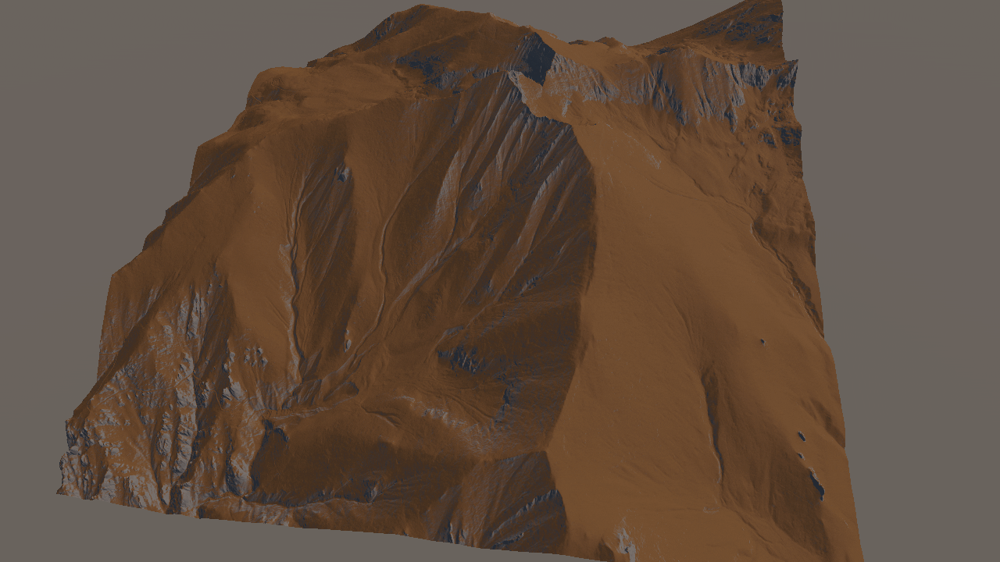
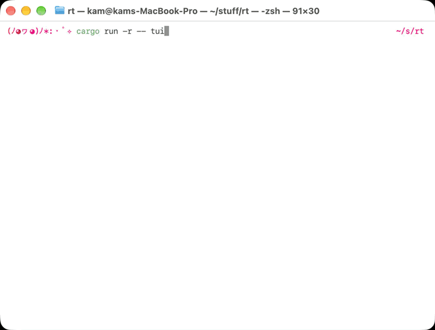

# Portfolio

## Physically based snow cover simulation

2026, C# (Unity)

Project for my master's research thesis. It's a grid based simulation method for the evolution of the snow cover on a large terrain throughout an entire winter season. It's been implemented in Unity using HPC#, capable of simulating terrains larger than 4k by 4k in real time. It's also designed as a standalone package that can be imported into other unity projects and integrates well with both game object and ECS paradigms. Documentation pending.

[repo](https://tangled.org/crow.garden/snow-sim)

## Ray tracer

2026-ongoing, Rust

A toy ray tracer made as a Rust programming exercise. It largely follows the implementation of Ray Tracing in One Weekend with several modifications. The general structure comes from the book but the implementation is completely original. Changes vary from those made to make better use of Rust's features to personal preference in the abstraction itself as well as additional features. Some additions include a more realistic (but equivalent) lens model and multithreading support.

In addition to the ray tracer the software also supports an interactive terminal application that renders directly to the terminal. Some planned additions include the ability to create and modify a scene from the TUI and rendering from there to a file, among others.

[repo](https://tangled.org/crow.garden/ray-tracing)

## Snail

2025-ongoing, C++ (OpenGL)

A graphics library and demo application made using C++ and OpenGL from scratch. Initially made to unify several university assignments but now I aim to make it a general purpose graphics library / engine for personal use.

[repo](https://tangled.org/crow.garden/snail)

## Work under NDA

2020-2024, C# (Unity)

Work done at Upknowledge developing VR applications for industrial training. Developed using Unity DOTS/ECS, includes optimising algorithms for high performance requirements with industrial level CAD models and the high refresh rates needed in VR.

## Blind Spot Virtual Gallery

2019, C# (Unity)

Art gallery made for Tampere University of Applied Sciences for its graduating fine art students as an immersive digital adaptation of their thesis projects. It includes a scene for each of the participants which were made collaboratively with each of them.

[itch.io](https://tamk.itch.io/blind-spot)

## Hot Futures Virtual Gallery

2018, C# (Unity)

Same as above but one year earlier.

[itch.io](https://tamk.itch.io/hot-futures)
